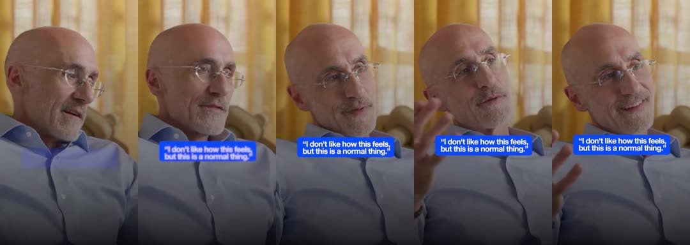

# v16_s23 · 01 Texto en pantalla (captions) · 56.9–59.3s (calidad 5)

- **Guion:** I don't like how this feels, but this is a normal thing.
- **Qué se ve:** Primer plano del speaker; cita completa en caja azul con esquinas ligeramente redondeadas: '“I don't like how this feels, but this is a normal thing.”'
- **Diseño:** Sans bold blanca en 2 líneas dentro de rectángulo azul #1E5BFF; tercio inferior-medio (~65 % altura), ~70 % ancho.
- **Efectos:** Cálido; caja plana.
- **Animación:** Caja pop/scale-in (≈0.2 s), texto completo a la vez.
- **Por qué aquí:** Frase para repetir (mantra) → se muestra entera, en caja, para que se pueda leer/capturar.
