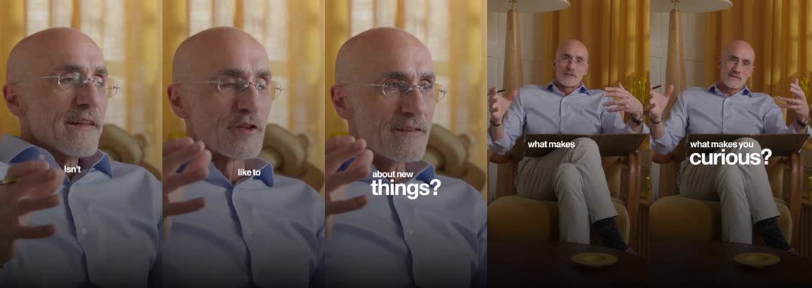

# v16_s29 · 01 Texto en pantalla (captions) · 73.4–77.0s (calidad 3)

- **Guion:** Isn't that how you like to learn about new things? Isn't this what makes you curious?
- **Qué se ve:** A-roll: 'That's' + 'interesting.', 'like to' + 'learn', 'Isn't' + 'this', 'what makes you'.
- **Diseño:** Sans bold blanca.
- **Efectos:** Cálido.
- **Animación:** Cortes de cámara en cada pregunta retórica.
- **Por qué aquí:** Preguntas retóricas → contacto visual con el espectador.
