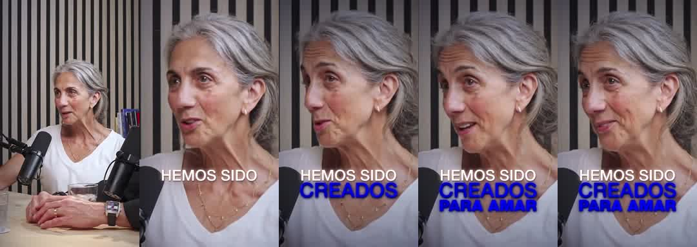

# v17_s01 · 01 Texto en pantalla (captions) · 0.0–1.6s (calidad 4)

- **Guion:** Hemos sido creados para amar.
- **Qué se ve:** Primer plano de la invitada (pelo canoso, camiseta blanca) frente a pared de listones de madera verticales; caption 'HEMOS SIDO' blanco + 'CREADOS' azul grande + 'PARA'. Logo pixelado blanco del canal (flecha de cuadros) fijo abajo-centro.
- **Diseño:** Sans grotesca black/heavy MAYÚSCULAS (tipo Helvetica Black/Montserrat ExtraBold); 'CREADOS' azul real #1A2BE0 con borde/sombra blanca, ~2x; tercio inferior-medio (~70 % altura). Logo ~8 % ancho a ~78 % altura.
- **Efectos:** Iluminación de estudio limpia; listones dan textura rayada; sin grano.
- **Animación:** Corte desde plano abierto (0.2 s) a primer plano; texto pop palabra a palabra con ligero blur.
- **Por qué aquí:** Hook con frase-tesis rotunda en boca de la invitada; la palabra azul es el concepto.
