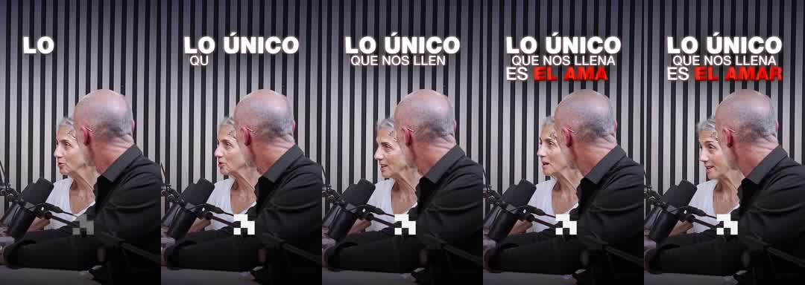

# v17_s02 · 01 Texto en pantalla (captions) · 1.6–3.3s (calidad 3)

- **Guion:** Lo único que nos llena es el amar.
- **Qué se ve:** Plano sobre el hombro de Arthur Brooks hacia la invitada (dos micrófonos); 'LO ÚNICO' grande + 'QUE NOS LLENA' en el tercio superior.
- **Diseño:** Sans heavy MAYÚSCULAS blanca, 'LO ÚNICO' ~2x; tercio superior (~15 % altura).
- **Efectos:** Estudio de podcast, fondo de listones negros/madera.
- **Animación:** Corte de cámara; texto pop.
- **Por qué aquí:** Plano de contexto (quién habla con quién) mientras la frase completa la tesis.
