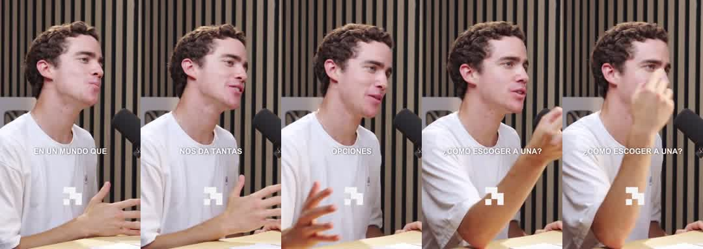

# v17_s11 · 01 Texto en pantalla (captions) · 34.5–37.3s (calidad 3)

- **Guion:** En un mundo que nos da tantas opciones, ¿cómo escogerá una?
- **Qué se ve:** Presentador joven (camiseta blanca, pelo rizado) preguntando; 'NOS DA TANTAS', '¿CÓMO ESCOGER A UNA?'.
- **Diseño:** Sans bold MAYÚSCULAS blanca pequeña, ~60 % altura.
- **Efectos:** Estudio.
- **Animación:** Corte a reacción del entrevistador.
- **Por qué aquí:** Pregunta del host = voz del espectador.
