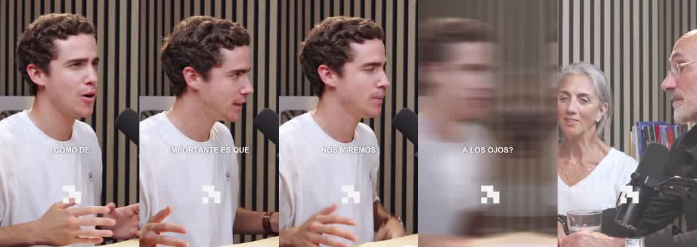

# v17_s15 · 01 Texto en pantalla (captions) · 45.3–48.5s (calidad 2)

- **Guion:** Cómo de importante es que nos miremos a los ojos.
- **Qué se ve:** Presentador primer plano; '¿CÓMO DE', 'A LOS OJOS?'.
- **Diseño:** Sans bold MAYÚSCULAS pequeña.
- **Efectos:** Estudio.
- **Animación:** Corte.
- **Por qué aquí:** Pregunta abierta = gancho a la parte siguiente (loop/curiosidad).
