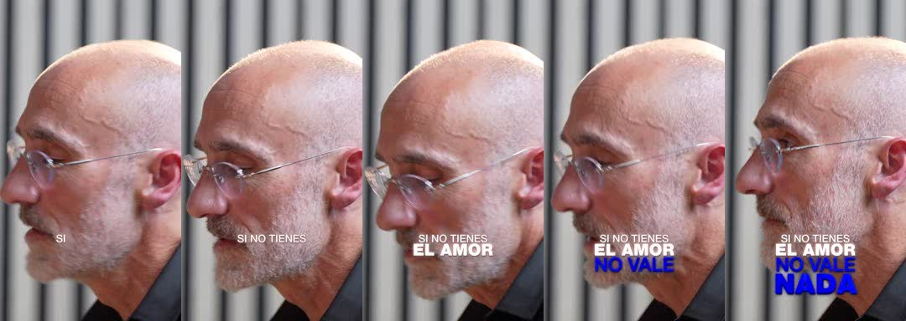

# v18_s02 · 01 Texto en pantalla (captions) · 6.7–8.4s (calidad 4)

- **Guion:** no tienes el amor no vale nada.
- **Qué se ve:** Primer plano de perfil de Arthur Brooks (gafas, barba) frente a listones; 'SI', luego 'SI NO TIENES' + 'EL AMOR' blanco + 'NO VALE NADA' azul grande apilado.
- **Diseño:** Sans heavy MAYÚSCULAS; 'NO VALE NADA' azul #1A2BE0 ~2x, borde blanco; bloque en tercio inferior-medio (~75 %).
- **Efectos:** Estudio; fondo listones desenfocado.
- **Animación:** Stack acumulativo palabra a palabra; pop.
- **Por qué aquí:** Remate del hook dicho por la autoridad: la palabra 'NADA' en azul cierra la promesa.
