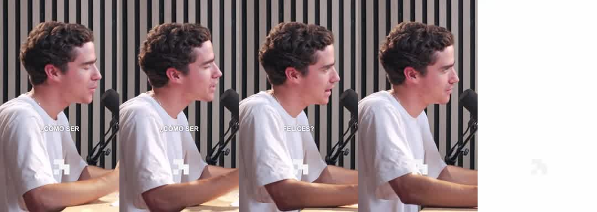

# v18_s03 · 01 Texto en pantalla (captions) · 8.4–9.6s (calidad 3)

- **Guion:** ¿Cómo ser felices?
- **Qué se ve:** Presentador joven de perfil preguntando; 'FELICES?'; el plano se tiñe de azul y luego flash blanco.
- **Diseño:** Sans bold MAYÚSCULAS pequeña centro.
- **Efectos:** Tinte azul (multiply) + flash blanco = transición de capítulo.
- **Animación:** Wash azul ~0.3 s → blanco.
- **Por qué aquí:** Pregunta = nuevo capítulo; la transición azul-blanco lo marca.
