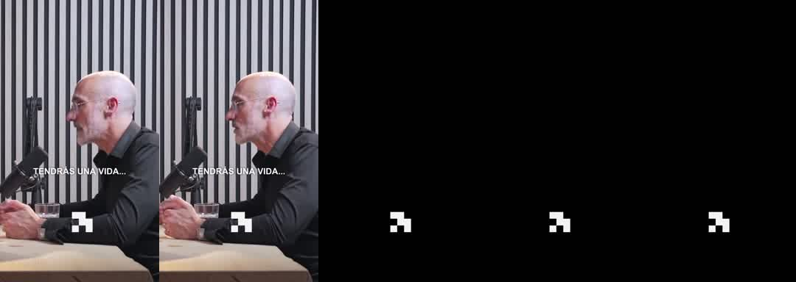

# v18_s08 · 01 Texto en pantalla (captions) · 19.4–22.1s (calidad 3)

- **Guion:** tendrás una vida...
- **Qué se ve:** Plano medio de Brooks en la mesa con micrófono; 'TENDRÁS UNA VIDA...'; luego plano negro con solo el logo (~1.3 s).
- **Diseño:** Sans bold MAYÚSCULAS pequeña; negro #000 con logo blanco.
- **Efectos:** Negro total.
- **Animación:** Corte a negro = pausa dramática.
- **Por qué aquí:** Frase suspendida + negro = silencio y fin de capítulo.
