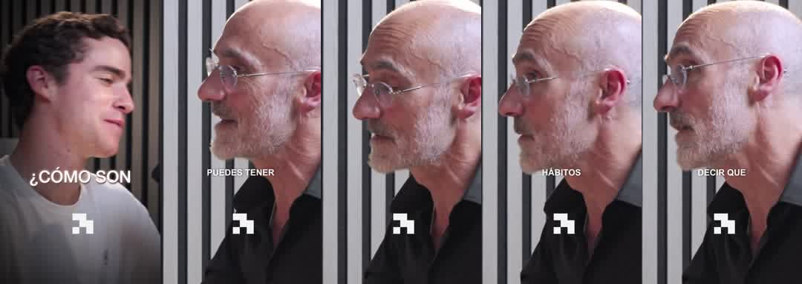

# v18_s09 · 01 Texto en pantalla (captions) · 22.1–30.8s (calidad 3)

- **Guion:** ¿Cómo son las personas más felices? Puedes tener mejores circunstancias, sistemáticamente, con mejores hábitos. Lo cual quiere decir que
- **Qué se ve:** Presentador '¿CÓMO SON LAS PERSONAS MÁS FELICES?' apilado ('MÁS FELICES?' azul); luego primer plano de perfil de Brooks con captions pequeños 'MEJORES', 'CIRCUNSTANCIAS', 'DECIR QUE'.
- **Diseño:** Pregunta en sans heavy MAYÚSCULAS grande apilada (~70 % altura) con remate azul; respuesta en pequeño.
- **Efectos:** Estudio, listones.
- **Animación:** Plano largo de Brooks con zoom lento.
- **Por qué aquí:** Pregunta destacada grande (voz del espectador); respuesta en plano sostenido.
