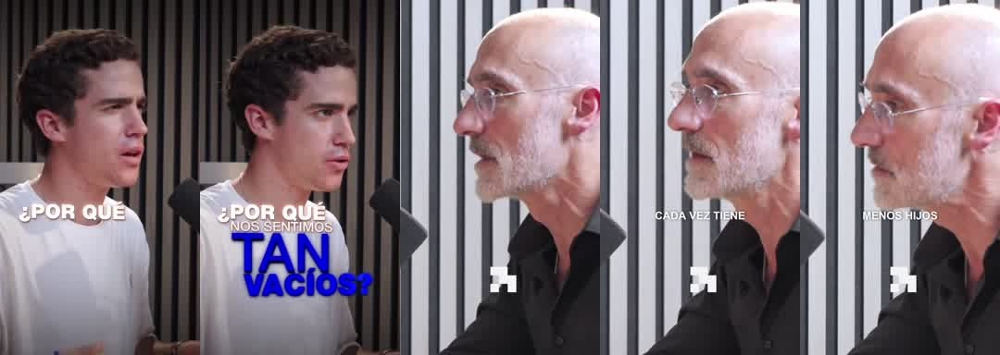

# v18_s12 · 01 Texto en pantalla (captions) · 36.6–43.8s (calidad 4)

- **Guion:** ¿Por qué nos sentimos tan vacíos en la era moderna? La gente se casa menos, la gente tiene menos hijos.
- **Qué se ve:** Presentador '¿POR' → '¿POR QUÉ NOS SENTIMOS' + 'TAN' azul gigante + 'VACÍOS?' azul; después perfil de Brooks 'MENOS LA GENTE', 'MENOS HIJOS'.
- **Diseño:** Pregunta apilada sans heavy, 'TAN VACÍOS?' azul con borde blanco ~ancho completo; tercio medio.
- **Efectos:** Estudio.
- **Animación:** Stack palabra a palabra con pop.
- **Por qué aquí:** Nueva pregunta-capítulo destacada; respuesta en pequeño.
