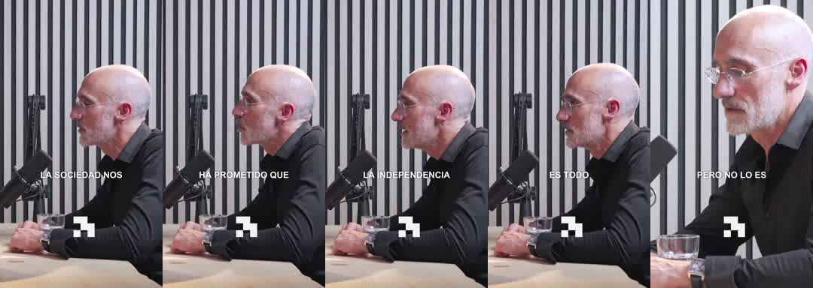

# v18_s13 · 01 Texto en pantalla (captions) · 43.8–48.2s (calidad 2)

- **Guion:** La sociedad nos ha prometido que la independencia es todo, pero no es.
- **Qué se ve:** Brooks plano medio en la mesa; 'LA SOCIEDAD NOS', 'HA PROMETIDO QUE', 'ES TODO', 'PERO NO LO ES'.
- **Diseño:** Sans bold MAYÚSCULAS pequeña centro.
- **Efectos:** Estudio.
- **Animación:** Plano sostenido.
- **Por qué aquí:** Argumento en cara (autoridad).
