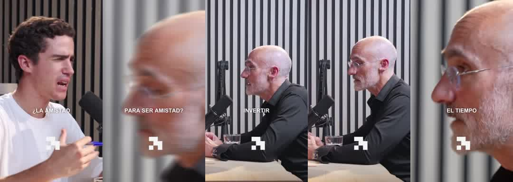

# v18_s14 · 01 Texto en pantalla (captions) · 48.2–56.2s (calidad 3)

- **Guion:** ¿La amistad requiere de algo para ser amistad? Sí, requiere tiempo, porque tienes que invertir. ¿Y qué es lo que inviertes? ¿El dinero? No, el tiempo.
- **Qué se ve:** Presentador 'REQUIERE DE ALGO' / 'PARA SER AMISTAD?'; primer plano extremo de Brooks 'SÍ REQUIERE'; plano medio 'TIENES QUE', '¿Y QUÉ ES LO QUE', '¿EL DINERO? NO', 'EL TIEMPO'.
- **Diseño:** Sans bold MAYÚSCULAS pequeña centro (~60 %).
- **Efectos:** Estudio.
- **Animación:** Ping-pong de planos pregunta/respuesta.
- **Por qué aquí:** Ritmo de diálogo socrático.
