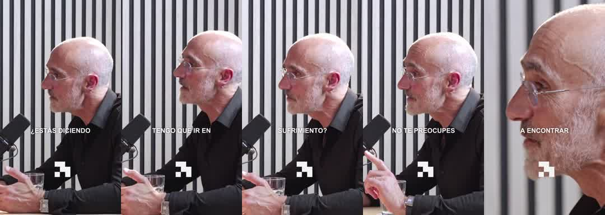

# v18_s15 · 01 Texto en pantalla (captions) · 56.2–64.4s (calidad 4)

- **Guion:** ¿Estás diciendo, profesor, que tengo que ir en búsqueda del sufrimiento? Yo les digo, no te preocupes, el sufrimiento te va a encontrar.
- **Qué se ve:** Tinte azul + flash blanco con '¿ESTÁS DICIENDO'; Brooks plano medio 'TENGO QUE IR EN', 'BÚSQUEDA DEL', 'YO LES DIGO', 'NO TE PREOCUPES'; primer plano final 'EL SUFRIMIENTO TE VA'.
- **Diseño:** Sans bold MAYÚSCULAS pequeña.
- **Efectos:** Wash azul + flash.
- **Animación:** Punch-in final al primer plano para el remate.
- **Por qué aquí:** Remate con humor; el primer plano final acerca la punchline.
