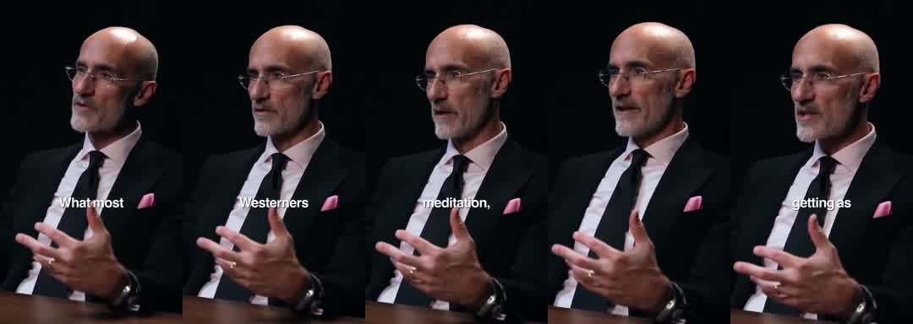

# v20_s01 · 01 Texto en pantalla (captions) · 0.0–3.5s (calidad 3)

- **Guion:** What most Westerners don't understand about meditation,
- **Qué se ve:** Plano medio-corto de Arthur Brooks (traje negro, camisa rosa, pañuelo rosa) sobre fondo negro absoluto, gesticulando; caption de 1–2 palabras 'Westerners', 'meditation,'.
- **Diseño:** Sans grotesca semibold blanca (tipo Inter/SF Pro), ~3.5 % altura, centrada a ~62 % altura (a la altura del pecho). Sin palabra destacada. Fondo #000, piel cálida, rosa #E58BB0 en pañuelo.
- **Efectos:** Iluminación de clave baja (low-key) lateral, negro profundo, sin grano visible.
- **Animación:** Captions palabra a palabra, aparición seca (corte, sin animación visible).
- **Por qué aquí:** Hook hablado: 'lo que los occidentales no entienden' = promesa de corregir un error. La estética sobria (negro) da seriedad.
