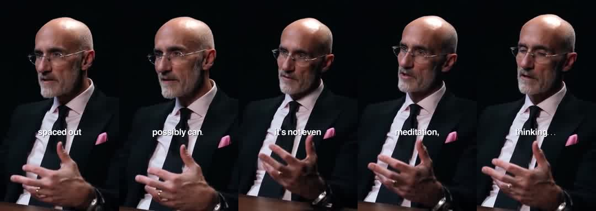

# v20_s02 · 01 Texto en pantalla (captions) · 3.5–10.1s (calidad 3)

- **Guion:** it's not getting as spaced out as you possibly can. You know, the single point meditation, it's not even the most common type of meditation. It's actually thinking seriously,
- **Qué se ve:** Mismo plano con punch-ins digitales (cambios de escala) cada 1.5–3 s; captions 'spaced out', 'possibly can', 'it's not even', 'meditation,', 'thinking...'.
- **Diseño:** Igual sistema de caption.
- **Efectos:** Low-key.
- **Animación:** Punch-in/out de escala (100 %→115 %) como corte invisible en cada frase.
- **Por qué aquí:** Plano largo del speaker sostenido con micro-zooms para mantener energía sin b-roll.
