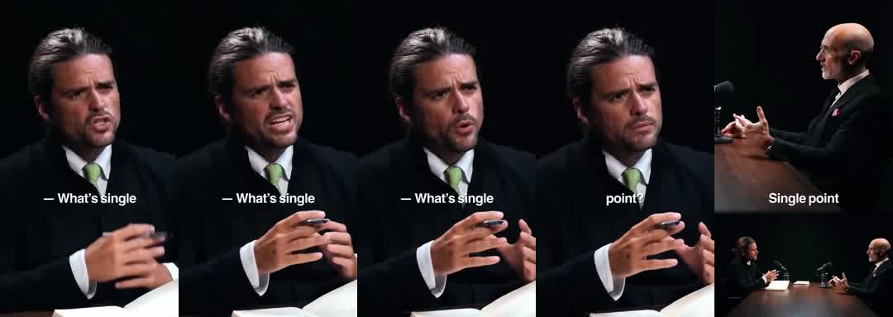

# v20_s03 · 01 Texto en pantalla (captions) · 10.1–11.1s (calidad 3)

- **Guion:** single
- **Qué se ve:** Contraplano del entrevistador (traje, corbata verde) interrumpiendo; caption '— What's single'.
- **Diseño:** Caption con raya de diálogo '—' para indicar otro hablante.
- **Efectos:** Low-key.
- **Animación:** Corte seco de 1 s.
- **Por qué aquí:** Reacción/pregunta del entrevistador da ritmo de conversación real.
