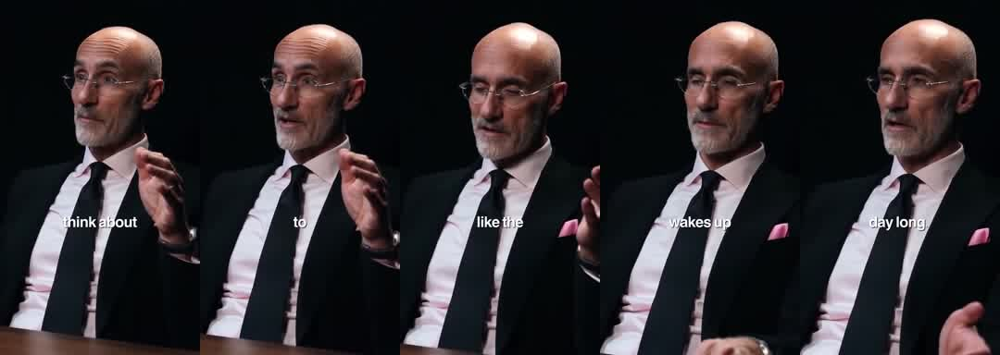

# v20_s06 · 01 Texto en pantalla (captions) · 24.5–30.5s (calidad 2)

- **Guion:** Your brain is not made to think about nothing to clear everything. But they think that like the Dalai Lama that just, you know,
- **Qué se ve:** Mismo encuadre con variación de escala; 'think about', 'clear', 'Dalai Lama,', 'he just'.
- **Diseño:** Igual.
- **Efectos:** Low-key.
- **Animación:** Punch-in al nombrar al Dalai Lama.
- **Por qué aquí:** Ejemplo concreto (personaje conocido) subrayado con zoom.
