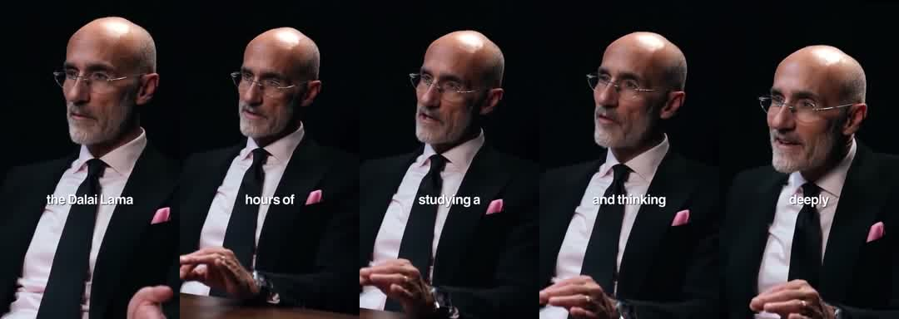

# v20_s07 · 01 Texto en pantalla (captions) · 30.5–37.9s (calidad 2)

- **Guion:** wakes up and just thinks about nothing all day long. I mean, the Dalai Lama wakes up the first two hours of his day are spent studying a piece of Tibetan scripture and thinking about it deeply for
- **Qué se ve:** Plano medio de Brooks; 'the Dalai Lama', 'hours of', 'Tibetan', 'about it'.
- **Diseño:** Igual.
- **Efectos:** Low-key.
- **Animación:** Plano sostenido con pequeños zooms.
- **Por qué aquí:** Dato revelador (2 horas de estudio) dicho a cámara.
