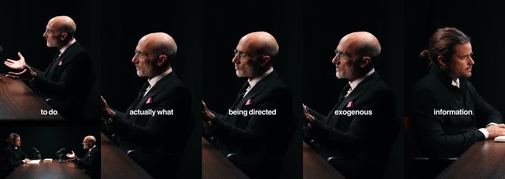

# v20_s10 · 01 Texto en pantalla (captions) · 44.5–50.0s (calidad 3)

- **Guion:** That's actually what you want as opposed to being directed by some exogenous source of information.
- **Qué se ve:** Plano de perfil completo de Brooks sentado a la mesa (a pantalla completa); 'actually what', 'being directed', 'exogenous'. Termina sin CTA.
- **Diseño:** Igual sistema.
- **Efectos:** Low-key, perfil recortado contra negro.
- **Animación:** Plano sostenido; corte final seco.
- **Por qué aquí:** Cierre en perfil reflexivo; sin CTA (formato clip).
