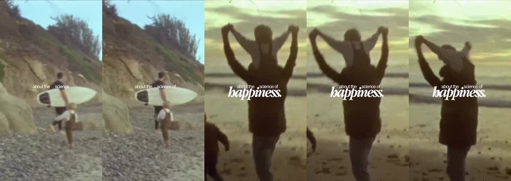

# v01_s05 · 02 B-roll + texto + overlay · 4.8–5.9s (calidad 4)

- **Guion:** of happiness.
- **Qué se ve:** B-roll cálido en dos planos rápidos: surfista caminando por la orilla, luego silueta de padre con niño a hombros en la playa al atardecer. Caption 'about the science of happiness.'
- **Diseño:** 'happiness.' serif itálica bold blanca grande (~9 % del alto); 'about the' y 'science of' sans pequeña arriba a izquierda/derecha. Centrado a ~50 %.
- **Efectos:** Stock con look película: tonos verdosos-dorados desaturados, grano suave, ligero halo.
- **Animación:** Cortes secos entre planos de b-roll (≈0.5 s); 'happiness.' entra con pop+blur→nítido (≈0.2 s).
- **Por qué aquí:** Da imagen emocional a un concepto abstracto (felicidad) justo cuando se nombra.
