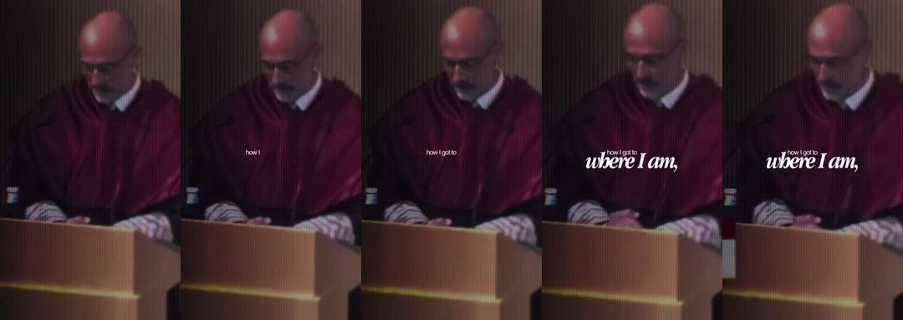

# v01_s11 · 02 B-roll + texto + overlay · 16.2–17.5s (calidad 4)

- **Guion:** how I got to where I am,
- **Qué se ve:** Video de archivo: Arthur con toga granate en un atril de madera, mirando hacia abajo. Caption 'how I got to / where I am,'.
- **Diseño:** 'where I am,' serif itálica bold blanca grande centrada; 'how I got to' sans pequeña arriba.
- **Efectos:** Archivo con grano y ligera suavidad, tonos cálidos.
- **Animación:** Corte seco; leve zoom-in del archivo; caption pop.
- **Por qué aquí:** Prueba de autoridad (toga, atril) justo cuando habla de 'dónde estoy'.
