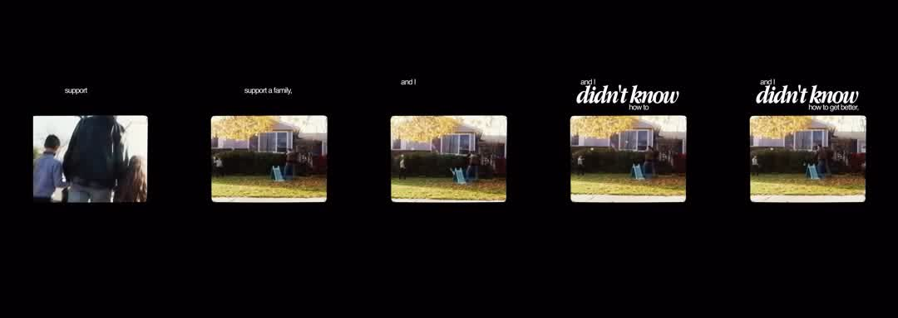

# v01_s25 · 02 B-roll + texto + overlay · 45.2–47.2s (calidad 4)

- **Guion:** support a family, and I didn't know how to get better,
- **Qué se ve:** Fondo negro con una tarjeta de video pequeña redondeada (casa con jardín y columpio otoñal). Caption pequeño 'support a family,' / 'and I'.
- **Diseño:** Tarjeta ~65 % ancho, esquinas redondeadas ~12 px, centrada a ~50 % alto; texto sans pequeña blanca encima de la tarjeta.
- **Efectos:** Negro puro alrededor (aislamiento), video cálido.
- **Animación:** Tarjeta aparece con pop+fade suave (≈0.3 s); leve escala.
- **Por qué aquí:** Momento íntimo y pequeño: el negro aísla la idea de 'familia'.
