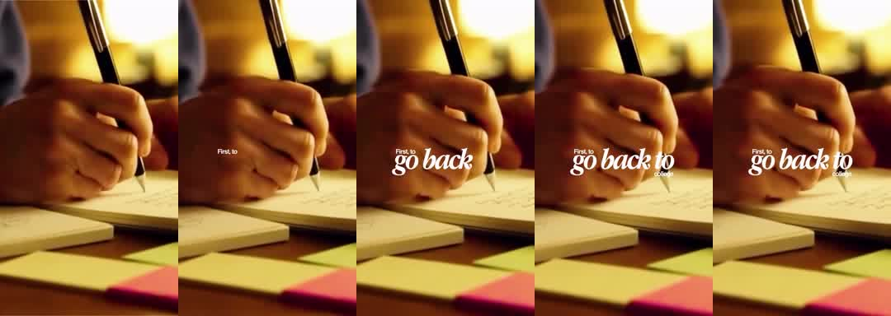

# v01_s30 · 02 B-roll + texto + overlay · 58.4–59.8s (calidad 4)

- **Guion:** first to go back to college, in
- **Qué se ve:** B-roll cálido macro: mano escribiendo con pluma sobre cuaderno con post-its amarillos/rosas. Caption 'First, to / go back'.
- **Diseño:** 'go back' serif itálica bold blanca grande al centro-derecha (~50 % alto); 'First, to' sans pequeña encima-izquierda.
- **Efectos:** Tonos ámbar/dorados, poca profundidad de campo, luz cálida.
- **Animación:** Corte seco; ligero movimiento de cámara del stock.
- **Por qué aquí:** Ilustra 'volver a estudiar' con una imagen universal (escribir).
