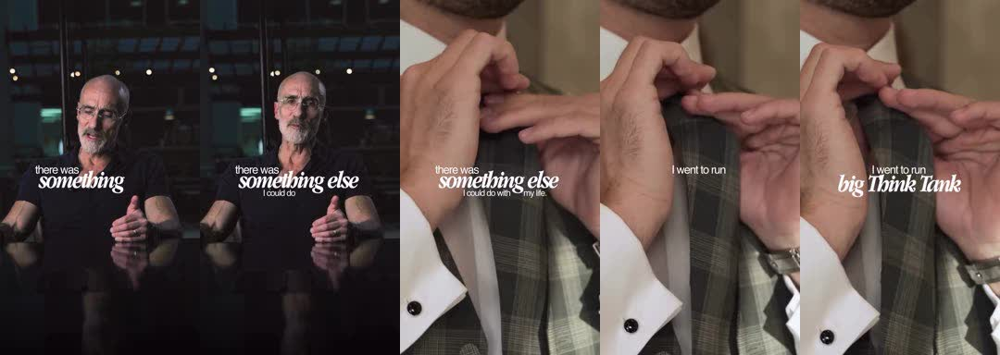

# v01_s38 · 02 B-roll + texto + overlay · 74.5–77.0s (calidad 4)

- **Guion:** something else I could do with my life. I went to run a big think
- **Qué se ve:** B-roll macro: manos abrochando el gemelo de un traje de cuadros. Caption 'there was / something else / I could do with my life.' y luego 'I went'.
- **Diseño:** 'something else' serif itálica bold blanca grande centrada; contexto sans pequeña arriba y abajo.
- **Efectos:** Luz natural suave, poca profundidad de campo.
- **Animación:** Corte seco; movimiento lento del stock.
- **Por qué aquí:** Metáfora visual de 'vestirse para otro rol' (el think tank).
