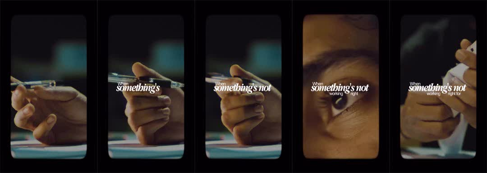

# v01_s46 · 02 B-roll + texto + overlay · 94.8–96.0s (calidad 4)

- **Guion:** something's not working right for
- **Qué se ve:** Fondo negro con tarjeta de video vertical redondeada: mano sosteniendo una pluma estilográfica. Caption 'When / something's not'.
- **Diseño:** Tarjeta ~80 % ancho y ~85 % alto con esquinas redondeadas grandes; 'something's' serif itálica bold blanca grande; 'When' sans pequeña.
- **Efectos:** Desenfoque fuerte del stock, tonos azul-ámbar.
- **Animación:** Tarjeta aparece con escala suave; corte seco.
- **Por qué aquí:** Formato íntimo (tarjeta sobre negro) para la parte 'lección'.
