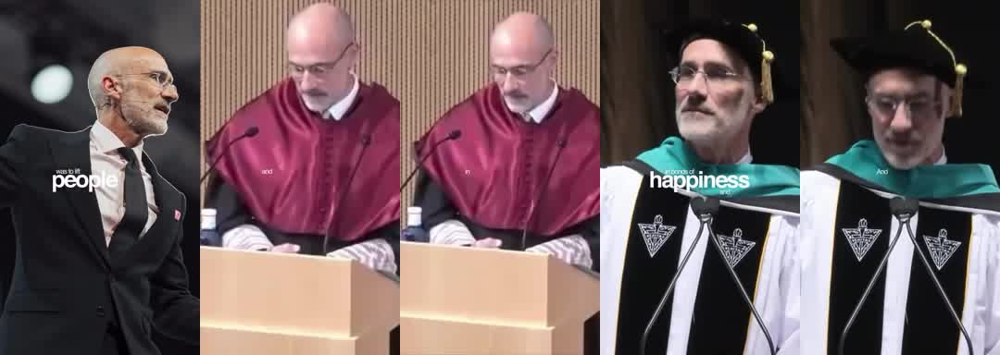

# v01_s56 · 02 B-roll + texto + overlay · 122.0–125.5s (calidad 4)

- **Guion:** lift people up and bring them together in bonds of happiness and love. And so
- **Qué se ve:** Montaje rápido de archivo: él con traje en un escenario ('was to lift'), hablando en charla ('people up'), con toga granate en atril ('together'), con toga doctoral verde/negra ('happiness').
- **Diseño:** Una palabra grande por plano en bold sans blanca ('people up', 'together', 'happiness') centrada ~50 %; contexto sans pequeña encima.
- **Efectos:** Archivo de eventos con iluminación de escenario variada.
- **Animación:** Cortes secos cada ≈0.7–1.5 s al ritmo de las palabras.
- **Por qué aquí:** Prueba de autoridad acumulada: el propósito ('elevar a la gente') se demuestra con su carrera pública.
