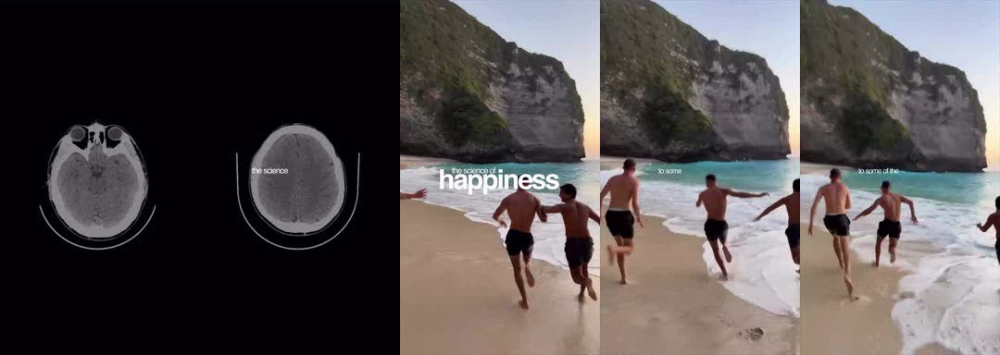

# v01_s60 · 02 B-roll + texto + overlay · 131.6–133.5s (calidad 4)

- **Guion:** the science of happiness to some of the finest
- **Qué se ve:** Dos planos rápidos: escáner cerebral (TAC) sobre negro ('the' = ciencia) y amigos corriendo hacia el mar en una playa con acantilado ('to').
- **Diseño:** TAC centrado ~60 % ancho sobre negro; caption sans pequeña.
- **Efectos:** TAC monocromo frío vs. playa saturada turquesa.
- **Animación:** Cortes secos ≈0.6–1.3 s.
- **Por qué aquí:** Contrapunto literal ciencia (cerebro) + felicidad (amigos).
