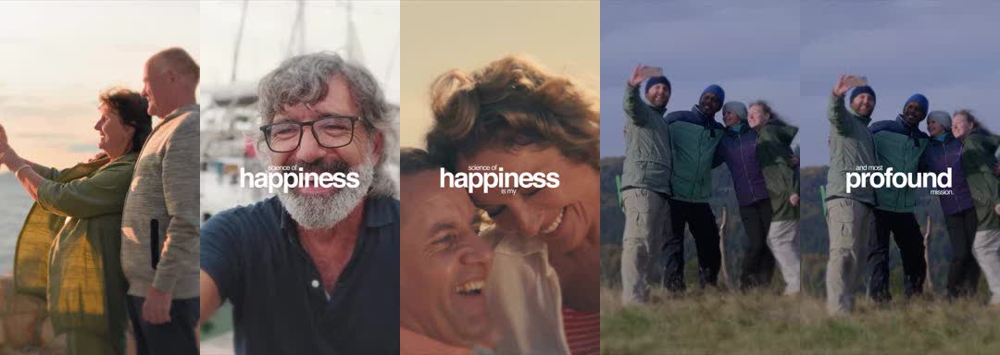

# v01_s65 · 02 B-roll + texto + overlay · 144.2–148.7s (calidad 4)

- **Guion:** the science of happiness is my life's deep and most profound mission.
- **Qué se ve:** Montaje de stock de felicidad: pareja mayor junto al mar, hombre con barba riendo, pareja abrazada riendo, hombre con gorro amarillo sonriendo, grupo de amigos haciéndose selfie en la montaña. Caption 'science of / happiness / is' repetido, 'and most'.
- **Diseño:** 'happiness' bold sans apretada blanca grande fija al centro (~50 %) mientras cambian los planos; contexto sans pequeña.
- **Efectos:** Stock cálido, luz dorada, colores naturales.
- **Animación:** Cortes secos cada ≈0.6–1 s bajo un caption que se mantiene fijo.
- **Por qué aquí:** Cierre emocional: la misión se asocia a caras felices diversas.
