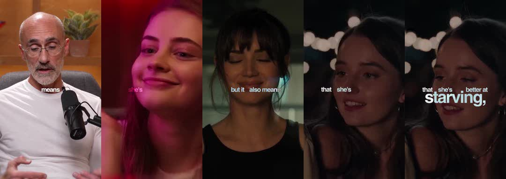

# v06_s21 · 02 B-roll + texto + overlay · 34.3–38.3s (calidad 4)

- **Guion:** which means she's better at bonding, but it also means that she's better at starving
- **Qué se ve:** Montaje de primeros planos de mujeres sonriendo: chica con luz neón rosa, chica con flequillo mirando abajo, chica con bokeh de luces.
- **Diseño:** Sans bold blanca pequeña ('she's', 'but it also means', 'that she's better at'); 'starving,' sans bold blanca grande. Centro.
- **Efectos:** Luz neón rosa/magenta, bokeh, gradación cinematográfica.
- **Animación:** Cortes por frase; write-on.
- **Por qué aquí:** Habla de 'ella' (la esposa): b-roll femenino emocional.
