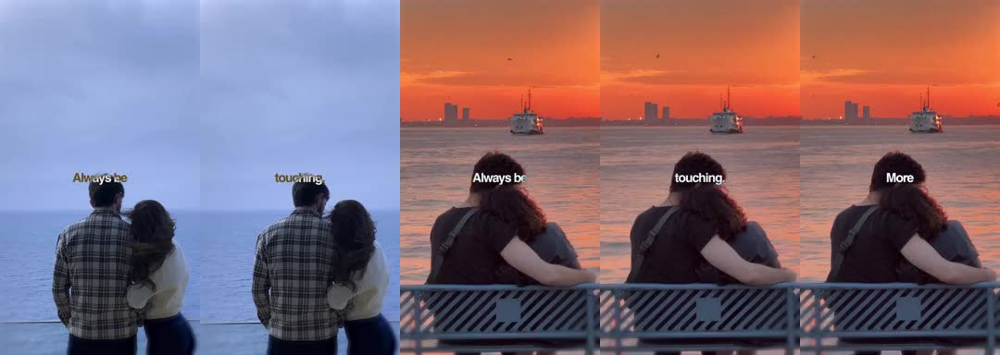

# v06_s25 · 02 B-roll + texto + overlay · 43.4–45.1s (calidad 4)

- **Guion:** always be touching, always be touching.
- **Qué se ve:** Dos b-rolls: pareja abrazada mirando al mar (cielo azul) y pareja abrazada en un banco ante un atardecer naranja con un ferry.
- **Diseño:** 'touching.' sans bold blanca pequeña centrada en el tercio superior (repetida).
- **Efectos:** Tonos fríos vs cálidos alternados.
- **Animación:** Corte en cada repetición de la frase (montaje a la repetición).
- **Por qué aquí:** La repetición verbal se acompaña de repetición visual = ritmo.
