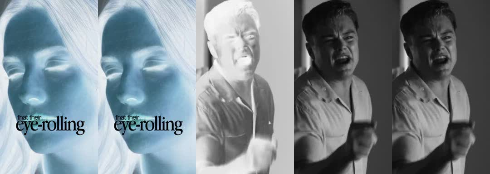

# v08_s03 · 02 B-roll + texto + overlay · 4.3–4.5s (calidad 4)

- **Guion:** —
- **Qué se ve:** Flash de 2–4 frames: la misma toma de la mujer en NEGATIVO (cian/blanco) con el texto 'eye-rolling' en negro, y luego el siguiente plano también en negativo.
- **Diseño:** Mismo texto invertido a negro.
- **Efectos:** Inversión de color (negativo), tono cian.
- **Animación:** Transición de impacto ~0.13 s entre dos b-rolls.
- **Por qué aquí:** Golpe visual que marca la transición al concepto 'odio'.
