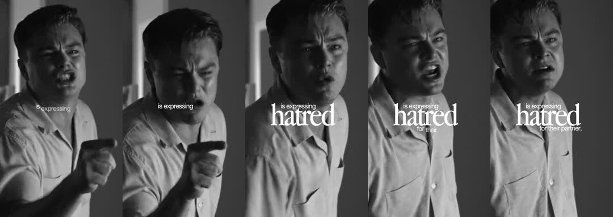

# v08_s04 · 02 B-roll + texto + overlay · 4.5–6.8s (calidad 5)

- **Guion:** expressing hatred for their partner,
- **Qué se ve:** Escena de película en B/N: actor con camisa blanca señalando con el dedo y gritando, luego en plano más cerrado.
- **Diseño:** 'is expressing' sans pequeña, 'hatred' serif condensada blanca grande, 'for their partner,' sans pequeña abajo-derecha. Tercio medio.
- **Efectos:** Blanco y negro de alto contraste, grano.
- **Animación:** Write-on; corte entre dos planos del mismo actor manteniendo el texto.
- **Por qué aquí:** Emoción intensa (odio) = personaje de cine reconocible en B/N; dramatiza.
