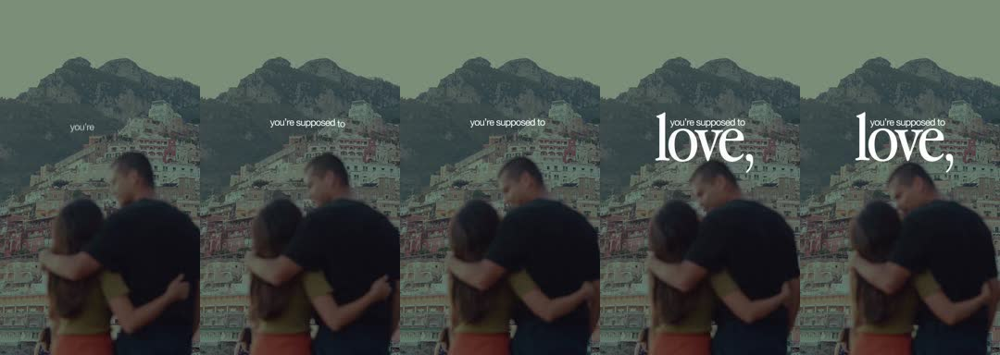

# v08_s07 · 02 B-roll + texto + overlay · 10.5–11.6s (calidad 4)

- **Guion:** you're supposed to love, that
- **Qué se ve:** Pareja abrazada de espaldas frente a un pueblo costero en la ladera (tipo Positano).
- **Diseño:** 'you're supposed to' sans pequeña, 'love,' serif condensada blanca enorme, tercio superior.
- **Efectos:** Tonos cálidos apagados, grano.
- **Animación:** Write-on; pop en 'love,'.
- **Por qué aquí:** Contrapunto emocional: la persona que deberías amar.
