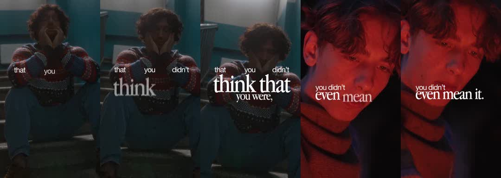

# v08_s18 · 02 B-roll + texto + overlay · 35.6–38.5s (calidad 4)

- **Guion:** that you didn't think that you were, you didn't even mean it.
- **Qué se ve:** Chico adolescente sentado en el suelo con la cabeza gacha (tonos fríos), luego primer plano del chico iluminado en rojo.
- **Diseño:** 'that you didn't' sans pequeña espaciada, 'think that' serif condensada blanca grande, 'you were,' sans pequeña; luego 'you didn't / even mean it.' serif.
- **Efectos:** Luz roja dramática, grano.
- **Animación:** Cambio de b-roll por frase; write-on.
- **Por qué aquí:** Culpa/arrepentimiento inconsciente: personaje joven, vulnerable.
