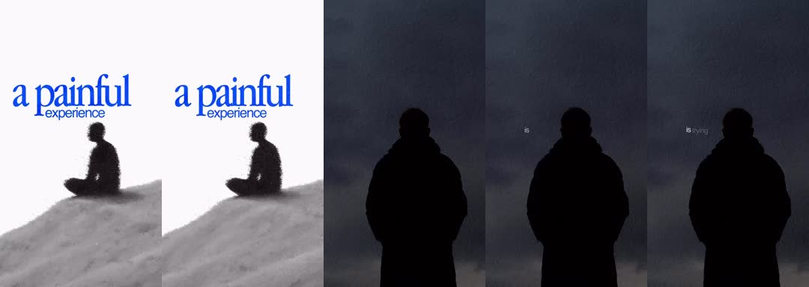

# v10_s03 · 02 B-roll + texto + overlay · 2.9–3.6s (calidad 3)

- **Guion:** is trying
- **Qué se ve:** Silueta negra de hombre con capucha de espaldas/frente contra cielo gris oscuro nublado. Texto 'is' y luego 'is trying' + 'get' en gris entrando.
- **Diseño:** 'is trying' sans pequeña blanca; 'get' serif condensada grande, primero gris al 40% y luego blanca. Centro-izquierda a media altura. Paleta gris-azulada desaturada.
- **Efectos:** Desaturación casi total, grano, tono frío.
- **Animación:** Write-on por palabra; la palabra grande entra en gris y 'se enciende' a blanco (fade de opacidad ~0.2 s). Corte seco al siguiente plano mientras la frase sigue (el texto continúa en el siguiente plano).
- **Por qué aquí:** Puente visual muy corto: la frase se escribe a través de varios planos, el texto es el hilo conductor y el b-roll cambia debajo.
