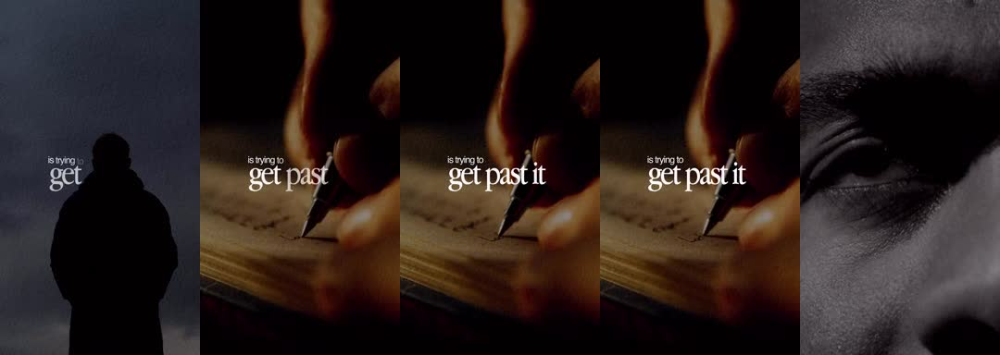

# v10_s04 · 02 B-roll + texto + overlay · 3.6–4.7s (calidad 4)

- **Guion:** to get past it
- **Qué se ve:** Primer plano cálido de una mano escribiendo con pluma estilográfica en un cuaderno, iluminación de vela/ámbar. 'is trying to' pequeño, 'get past it' grande.
- **Diseño:** 'get past it' serif condensada blanca grande (alto contraste), 'is trying to' sans pequeña encima a la izquierda como super-índice. Centrado, ligeramente sobre la mitad. Tonos ámbar #8A4A20 / negros profundos.
- **Efectos:** Gradación cinematográfica cálida, poca profundidad de campo, grano de película.
- **Animación:** El texto se mantiene desde el plano anterior y completa 'past it' por palabras; corte seco del b-roll; sin movimiento de cámara añadido.
- **Por qué aquí:** Metáfora visual de 'pasar página' (escribir/cerrar capítulo). Continuidad de texto sobre corte = ritmo fluido.
