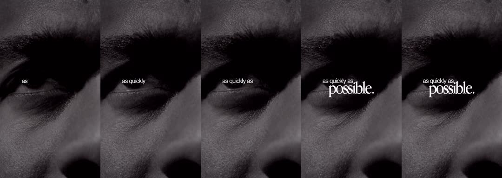

# v10_s05 · 02 B-roll + texto + overlay · 4.7–5.9s (calidad 4)

- **Guion:** as quickly as possible.
- **Qué se ve:** Extremo primer plano en B/N del ojo y ceja de un hombre (tenso). 'as quickly as' pequeño y 'possible.' grande.
- **Diseño:** 'as quickly as' sans regular blanca pequeña; 'possible.' serif condensada blanca grande con punto final, alineada debajo a la derecha. Tercio superior-medio, sobre el ojo.
- **Efectos:** Blanco y negro con contraste alto, textura de piel con grano, sin color.
- **Animación:** Write-on por palabra (~0.25 s por palabra), la palabra clave pop + leve blur-in. Cámara casi estática (micro push).
- **Por qué aquí:** La mirada tensa = urgencia de huir del dolor; la palabra 'possible.' cierra la idea con un punto, sensación de sentencia.
