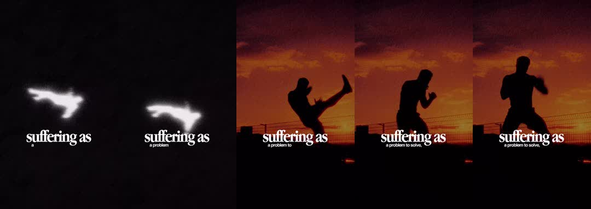

# v10_s10 · 02 B-roll + texto + overlay · 12.5–14.1s (calidad 4)

- **Guion:** a problem to solve,
- **Qué se ve:** B-roll de silueta de hombre haciendo patada/shadowboxing contra atardecer naranja intenso, valla y edificios. El texto 'suffering as' se mantiene y debajo crece 'a problem to solve,'.
- **Diseño:** 'suffering as' serif condensada blanca (mismo tamaño y posición que en s09: continuidad); 'a problem to solve,' sans pequeña blanca debajo. Tercio inferior-centro. Naranjas #C85A1A, negros.
- **Efectos:** Contraluz, grano de película, cálido saturado.
- **Animación:** Corte seco desde el strobe manteniendo el texto en el mismo sitio; write-on por palabra de la línea pequeña. El sujeto se mueve (acción) pero la cámara está fija.
- **Por qué aquí:** Tratar el sufrimiento 'como un problema a resolver' = pelearlo; la imagen de lucha lo literaliza. Mantener el texto fijo sobre el corte enlaza ideas.
