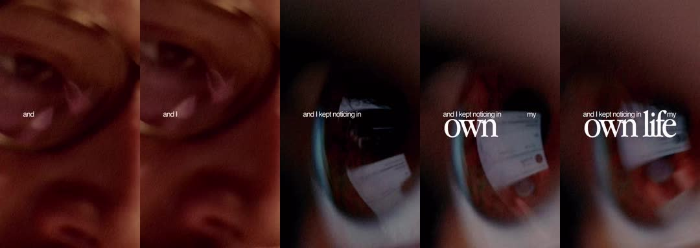

# v10_s12 · 02 B-roll + texto + overlay · 17.7–19.4s (calidad 4)

- **Guion:** and I kept noticing in my own life
- **Qué se ve:** Extremo primer plano de un ojo (gafas desenfocadas → iris) con el reflejo de un papel/recibo; luego 'and I kept noticing in' pequeño, 'my' pequeño y 'own life' grande.
- **Diseño:** 'own life' serif condensada blanca grande, 'my' sans pequeña super-índice a la derecha; 'and I kept noticing in' sans pequeña. Mitad de pantalla, centrado. Tonos marrón/rojizo cálido con azul del iris.
- **Efectos:** Macro con desenfoque, grano, tono cálido de película.
- **Animación:** Pequeño rack focus/movimiento en el ojo; write-on por palabra; 'own' aparece antes que 'life' (palabra a palabra incluso en lo grande).
- **Por qué aquí:** 'Notar' = ojo; la imagen literal de observar. Introduce la evidencia personal antes de la investigación.
