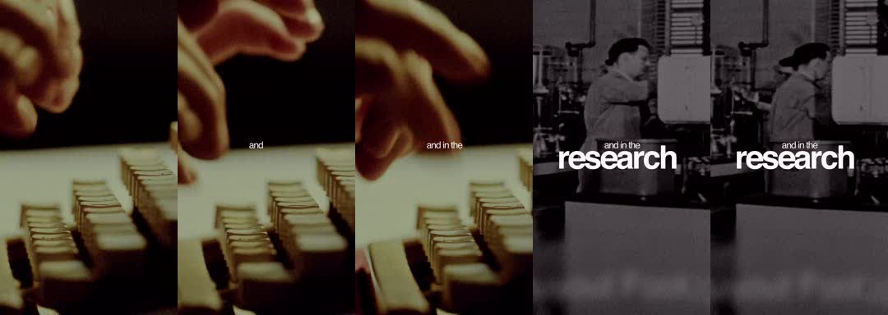

# v10_s13 · 02 B-roll + texto + overlay · 19.4–20.8s (calidad 4)

- **Guion:** and in the research
- **Qué se ve:** Manos tecleando en una máquina de escribir antigua (cálido, desenfocado) con 'and', 'and in the'; corte a metraje de archivo B/N de un científico en un laboratorio con 'research' enorme.
- **Diseño:** 'research' sans grotesca BOLD blanca (no serif: variación tipográfica para 'dato/ciencia'), 'and in the' sans pequeña encima. Tercio medio-superior centrado. Archivo B/N gris #808080.
- **Efectos:** B/N de archivo con grano y suavidad, ligera borrosidad en la parte baja (como texto quemado/rótulo), cálido en el plano de la máquina.
- **Animación:** Corte seco de la máquina al archivo justo en 'research'; la palabra grande hace pop (escala 95→100% + fade, ~0.15 s).
- **Por qué aquí:** Cambio de prueba personal a prueba científica: archivo de laboratorio = autoridad. Sans bold para lo 'objetivo', serif para lo emocional.
