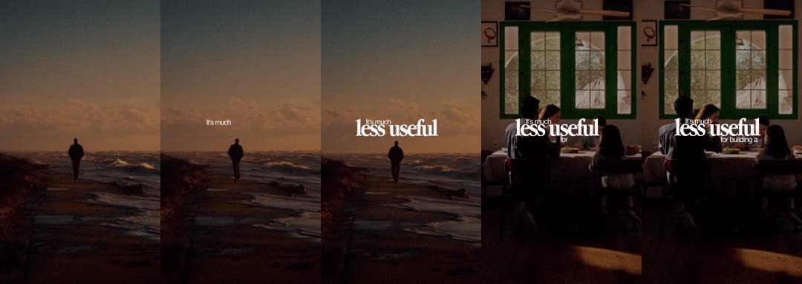

# v10_s20 · 02 B-roll + texto + overlay · 32.5–34.5s (calidad 4)

- **Guion:** It's much less useful for building a
- **Qué se ve:** Hombre caminando solo por una playa al atardecer (cálido, olas) con 'It's much' y 'less useful'; corte a una familia cenando en una casa con ventanas verdes con 'for building a'.
- **Diseño:** 'less useful' serif condensada blanca grande, 'It's much' sans pequeña encima, 'for building a' sans pequeña debajo. Centro de pantalla. Tonos ámbar/teal cinematográficos.
- **Efectos:** Grano de película, textura de papel sutil, gradación cálida.
- **Animación:** Texto persistente a través del corte entre los dos b-rolls; write-on por palabra.
- **Por qué aquí:** Pasa de lo biológico a lo humano/vital: soledad (playa) vs construir vida (familia).
