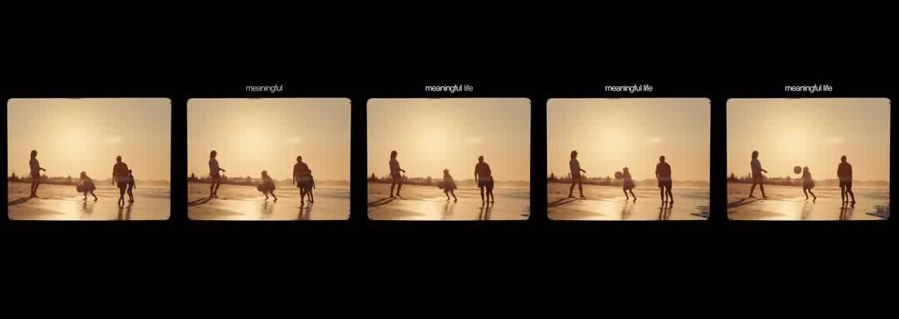

# v10_s21 · 02 B-roll + texto + overlay · 34.5–35.5s (calidad 4)

- **Guion:** meaningful life
- **Qué se ve:** Fondo negro; tarjeta de foto con esquinas redondeadas y borde de película: familia jugando con una pelota en la playa a contraluz dorado. 'meaningful life' pequeño sobre la tarjeta.
- **Diseño:** Sans pequeña blanca centrada encima de la tarjeta; tarjeta ocupa ~90% ancho, centrada verticalmente, radio ~3%. Fondo #000.
- **Efectos:** Marco de película/diapositiva con bordes irregulares, cálido sobreexpuesto, grano.
- **Animación:** Tarjeta aparece estática (vídeo dentro); texto write-on palabra a palabra ('meaningful' en gris y luego 'life').
- **Por qué aquí:** La 'vida con sentido' se presenta como un recuerdo enmarcado (nostalgia/álbum).
