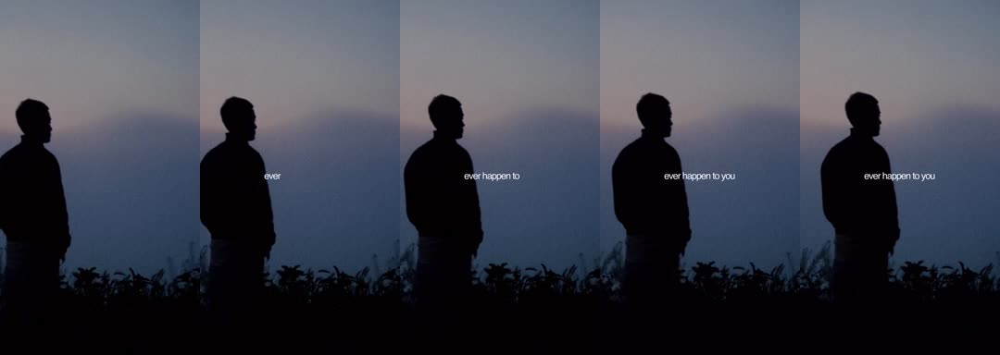

# v10_s24 · 02 B-roll + texto + overlay · 37.5–39.0s (calidad 3)

- **Guion:** ever happen to you
- **Qué se ve:** Silueta de hombre de perfil contra cielo azul crepuscular con niebla sobre montañas. 'ever happen to you' pequeño en el centro.
- **Diseño:** Sans pequeña blanca centrada a media altura. Azules #4A5A80, negro.
- **Efectos:** Contraluz, niebla atmosférica, grano.
- **Animación:** Write-on por palabra; leve movimiento de cámara.
- **Por qué aquí:** Respiro contemplativo; texto pequeño = frase de tránsito.
