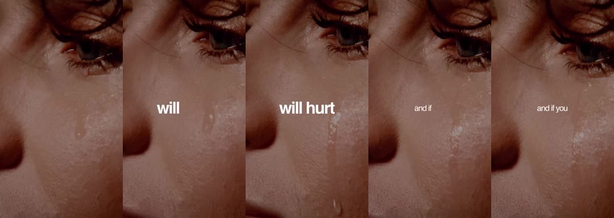

# v10_s25 · 02 B-roll + texto + overlay · 39.0–40.4s (calidad 4)

- **Guion:** will hurt, and if you
- **Qué se ve:** Primerísimo plano de la mejilla y el ojo de una mujer con una lágrima corriendo. 'will' → 'will hurt' grande; luego 'and if' / 'and if you' pequeño.
- **Diseño:** 'will hurt' sans grotesca bold blanca grande; 'and if you' sans regular pequeña. Centro de pantalla. Tonos piel cálidos.
- **Efectos:** Macro, piel con textura, grano, cálido.
- **Animación:** Write-on por palabra; 'will hurt' se sustituye por la siguiente frase (no acumula).
- **Por qué aquí:** Momento emocional = b-roll humano con lágrima, literal y directo.
