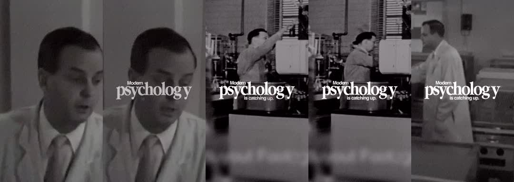

# v10_s29 · 02 B-roll + texto + overlay · 47.4–49.7s (calidad 5)

- **Guion:** Modern psychology is catching up.
- **Qué se ve:** Archivo B/N a pantalla completa: psicólogo/científico con bata, luego en laboratorio con máquinas. 'Modern' pequeño bold, 'psychology' enorme, 'is catching up.' pequeño.
- **Diseño:** 'psychology' serif condensada blanca enorme con la 'y' final separada (kerning abierto 'psycholog y'); 'Modern' sans bold pequeña arriba-izquierda; 'is catching up.' sans regular pequeña debajo-derecha. Tercio medio.
- **Efectos:** B/N de archivo, grano, ligera borrosidad inferior.
- **Animación:** 'psychology' entra en gris semitransparente y se ilumina a blanco (~0.3 s); 'catching' y 'up.' entran grises y se aclaran. La 'y' separada da sensación de que la palabra 'se alcanza a sí misma'. Cortes entre 3 clips de archivo manteniendo el texto fijo.
- **Por qué aquí:** Contraste antiguo (budismo) vs moderno (ciencia) dentro del mismo lenguaje de archivo; detalle tipográfico juguetón en 'catching up'.
