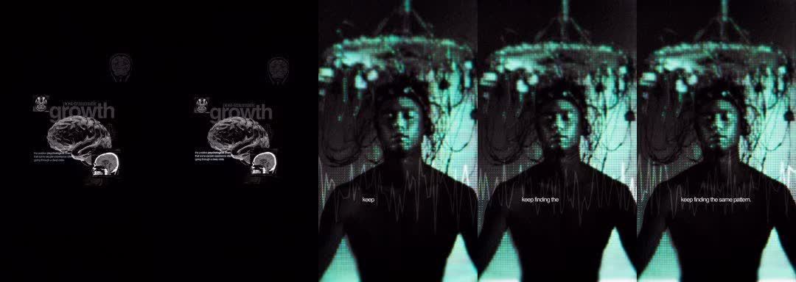

# v10_s31 · 02 B-roll + texto + overlay · 51.0–53.6s (calidad 4)

- **Guion:** keep finding the same pattern.
- **Qué se ve:** Mujer con gorro de electrodos EEG y cables, tratada en duotono cian/teal con halftone; una forma de onda (EEG) blanca cruza la imagen. 'keep finding the same pattern.' pequeño.
- **Diseño:** Sans pequeña blanca en el tercio medio-inferior. Teal #5CE0D0 sobre negro.
- **Efectos:** Duotono, halftone/punteado, líneas de onda superpuestas, glitch suave.
- **Animación:** Push-in lento; la onda se desplaza horizontalmente; texto write-on.
- **Por qué aquí:** 'Patrón' + investigación = medición cerebral; el duotono separa visualmente la ciencia de las escenas emocionales cálidas.
