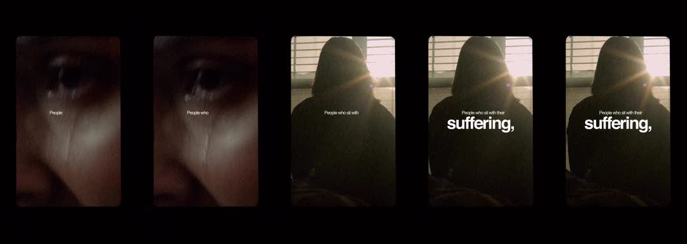

# v10_s32 · 02 B-roll + texto + overlay · 53.6–55.5s (calidad 4)

- **Guion:** People who sit with their suffering,
- **Qué se ve:** Fondo negro con tarjeta redondeada: primero ojo con lágrima, luego mujer en silueta junto a una ventana con sol y destello. 'People who sit with their' pequeño y 'suffering,' grande.
- **Diseño:** 'suffering,' sans bold blanca, resto sans pequeña. Centro de la tarjeta. Tarjeta ~80% ancho.
- **Efectos:** Lens flare, contraluz, cálido, grano.
- **Animación:** Corte dentro de la tarjeta; texto acumulativo palabra a palabra.
- **Por qué aquí:** Retrata la actitud sana (sentarse con el dolor) con una figura quieta en la luz = esperanza.
