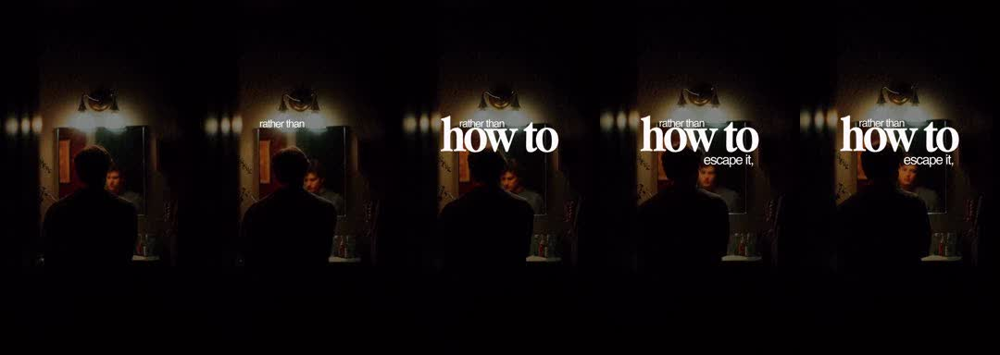

# v10_s34 · 02 B-roll + texto + overlay · 57.2–59.0s (calidad 4)

- **Guion:** rather than how to escape it,
- **Qué se ve:** Hombre de espaldas frente a un espejo de baño con lámpara, oscuro. 'rather than' pequeño, 'how to' enorme, 'escape it,' pequeño.
- **Diseño:** 'how to' serif condensada blanca muy grande, 'rather than' sans pequeña super-índice, 'escape it,' sans pequeña debajo a la derecha. Tercio superior-medio.
- **Efectos:** Low-key, grano, cálido tungsteno.
- **Animación:** Write-on por palabra; cámara fija.
- **Por qué aquí:** Contrapone la pregunta equivocada con imagen de introspección forzada (espejo).
