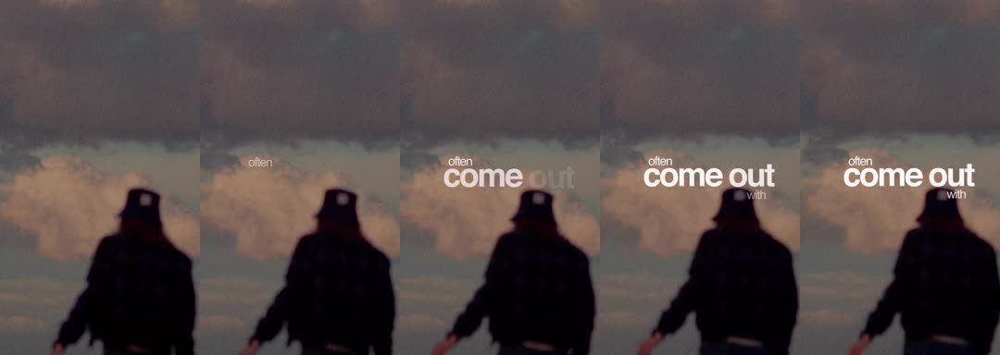

# v10_s35 · 02 B-roll + texto + overlay · 59.0–60.2s (calidad 3)

- **Guion:** often come out with
- **Qué se ve:** Persona con gorro de pescador de espaldas desenfocada contra nubes cálidas. 'often' pequeño, 'come out' grande (con 'out' gris aclarándose), 'with' pequeño.
- **Diseño:** 'come out' sans bold blanca, resto sans pequeña. Centro-izquierda media altura. Tonos melocotón/azul.
- **Efectos:** Desenfoque, grano, colores pastel de atardecer.
- **Animación:** Write-on; palabra clave entra gris y se ilumina.
- **Por qué aquí:** Salida/emergencia: figura moviéndose hacia el cielo abierto.
